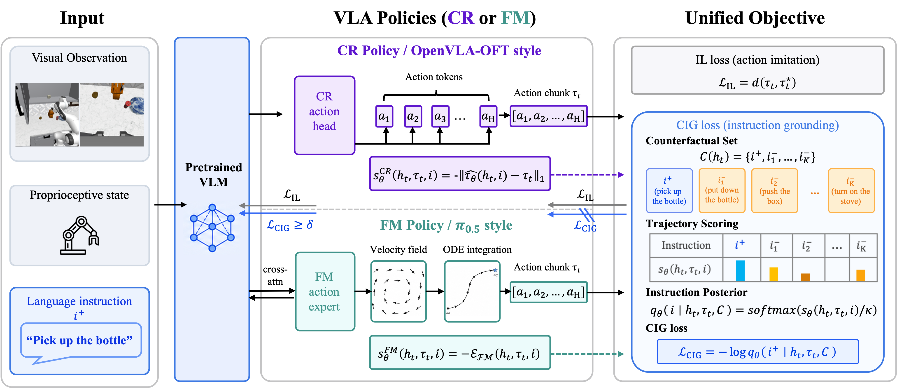
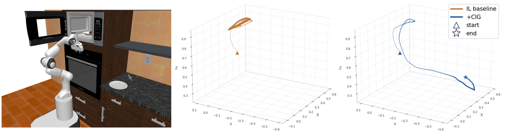
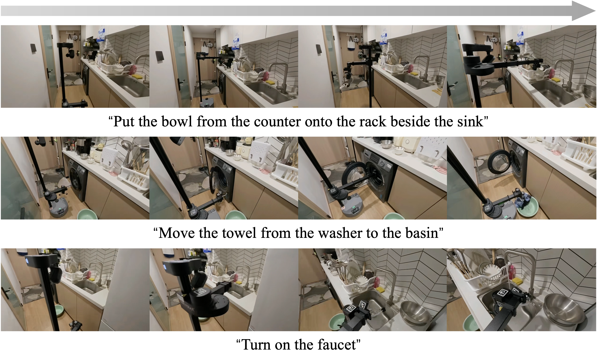
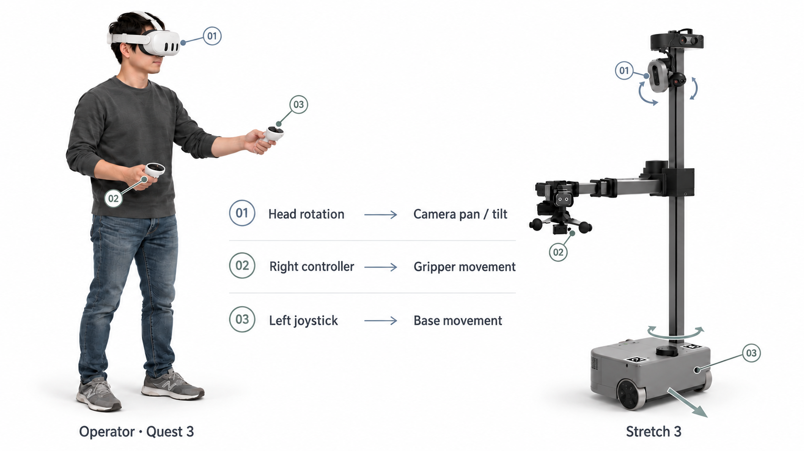

<div align="center">
<h2>[NeurIPS 2026] Counterfactual Instruction Grounding<br>for Vision-Language-Action Models</h2>

<p align="center">
  Shiyu Liu · Yu Zhou · Meng Liu · Xuanming Guo · Liqiang Nie
</p>
</div>

<p align="center">
  <a href="https://github.com/bjzgcai">
    
  </a>
  <a href="https://huggingface.co/SeeYooLeo/CIG-RoboCasa-Kitchen">
    
  </a>
</p>

<!-- Add public paper and project links when available. -->
<p align="center">
  <a href="#overview">Overview</a> &nbsp;·&nbsp;
  <a href="#method">Method</a> &nbsp;·&nbsp;
  <a href="#robocasa-kitchen-evaluation">Results</a> &nbsp;·&nbsp;
  <a href="#real-robot-and-vr-demonstrations">Real Robot</a> &nbsp;·&nbsp;
  <a href="#vr-data-collection">VR Data Collection</a><br>
  <a href="#environment">Environment</a> &nbsp;·&nbsp;
  <a href="#robocasa-kitchen-data">Data</a> &nbsp;·&nbsp;
  <a href="#model-checkpoints">Checkpoints</a> &nbsp;·&nbsp;
  <a href="#training">Training</a> &nbsp;·&nbsp;
  <a href="#inference-and-evaluation">Inference</a> &nbsp;·&nbsp;
  <a href="#citation">Citation</a>
</p>

<a id="overview"></a>

## 📖 Overview

Vision-language-action models can remain visually reactive while drifting away from the commanded task during execution. The paper traces this failure to a loss of instruction-sensitive representations across network depth and task progress: imitation learning alone can fit demonstrations through visual shortcuts without preserving language dependence.

**Counterfactual Instruction Grounding (CIG)** treats grounding as an identification problem: given the observation and the same action chunk, the commanded instruction should be distinguishable from counterfactual alternatives. CIG augments imitation learning during continuation training, without changing the model architecture or collecting additional demonstrations.

This release contains the **robocasa-kitchen** training and evaluation code, four simulator checkpoints, and supplementary **Stretch 3 VR** collection and replay tools.

<a id="highlights"></a>

## 💡 Highlights

- **Grounding beyond imitation.** CIG explicitly compares the commanded instruction with alternative task interpretations for the same demonstrated action chunk.
- **Targeted representation updates.** The paper combines VLM-only CIG gradient routing with a saturation gate, while the action expert remains governed by imitation learning.
- **robocasa-kitchen gains on both model families.** The paper reports **65.8% → 71.3%** for π0.5 and **40.7% → 47.7%** for OpenVLA-OFT.
- **Real-world kitchen manipulation.** On three Stretch 3 tasks, the paper reports **23.3% → 56.7%** overall success over 60 rollouts per method.

<a id="method"></a>

## 🧠 Method

1. **Construct counterfactual instructions.** Pair the commanded instruction with alternatives from the existing instruction pool. The paper uses category-aware sampling; negative instructions do not require corresponding expert trajectories.
2. **Score the same action chunk.** Convert instruction-conditioned scores into a contrastive posterior and maximize the probability of the commanded instruction. The released OFT uses negative mean L1 action error; π0.5 uses flow-matching residual energy. These instantiate the continuous-regression (CR) and flow-matching (FM) branches of the same contrastive objective.
3. **Route and gate the grounding gradient.** Imitation learning updates all trainable modules. CIG updates the VLM representation when the grounding loss is at least the saturation floor δ.

<p align="center">
  
</p>
<p align="center"><em>CIG for continuous-regression (CR) and flow-matching (FM) policies. Both branches score the same action chunk against candidate instructions.</em></p>

OpenVLA-OFT instantiates CR with negative mean L1 action error; π0.5 instantiates FM with residual energy using shared noise and time. The [paper and implementation notes](docs/paper.md) describe the scoring implementations and the shared Appendix C continuation settings.

<a id="robocasa-kitchen-evaluation"></a>

## 📊 robocasa-kitchen evaluation

The paper reports success rate (**SR, %**) on **24 single-stage tasks**, with **50 rollouts per task**. The table below contains the four released model variants; changes are absolute percentage points.

| Model | Pick & Place | Open & Close | Knob & Lever | Button | Insertion | Average | Change |
|---|---:|---:|---:|---:|---:|---:|---:|
| OpenVLA-OFT | 14.8 | 63.7 | 50.4 | 54.0 | 31.0 | 40.7 | — |
| **OpenVLA-OFT + CIG** | 20.3 | 73.3 | 48.4 | **85.3** | 22.0 | **47.7** | **+7.0** |
| π0.5 | 56.5 | 83.0 | 62.4 | 80.7 | 38.0 | 65.8 | — |
| **π0.5 + CIG** | **64.8** | **86.7** | **65.6** | 84.0 | **47.0** | **71.3** | **+5.5** |

π0.5 improves across all five categories. OFT improves on average, with its largest gain on Button tasks, while Knob & Lever and Insertion decline. These are manuscript-reported results; evaluation commands below generate new measurements.

<p align="center">
  
</p>
<p align="center"><em>Qualitative trajectories on PnPMicrowaveToCounter from the manuscript: CIG produces a more directed reach-and-place trajectory. Triangles and stars mark start and end waypoints.</em></p>

<details>
<summary><strong>Ablation and instruction-grounding diagnostic</strong></summary>

The manuscript adds CIG components incrementally on robocasa-kitchen:

| Variant | OpenVLA-OFT SR (%) | π0.5 SR (%) |
|---|---:|---:|
| Baseline | 40.7 | 65.8 |
| + CIG loss | 44.9 | 68.2 |
| + VLM-only routing | 46.2 | 69.1 |
| + Saturation gate | **47.7** | **71.3** |

The grounding diagnostic uses the same frozen pre-CIG IL checkpoint to score both policies' rollouts. Instruction identification accuracy increases from **85.8% to 91.5%**, and the commanded instruction's posterior probability increases from **0.409 to 0.514**. Each evaluated policy supplies 360 rollout chunks: 5 rollouts per task and 3 non-idle chunks per rollout, compared against 4 negative instructions.

</details>

Both released policies predict 10-step action chunks; evaluation executes 5 steps before replanning. See the [evaluation guide](evaluation/README.md) for held-out objects, fixed layouts/styles and task horizons.

<a id="real-robot-and-vr-demonstrations"></a>

## 🤖 Real-robot experiments

<a id="stretch-3-experiments-in-the-paper"></a>

### 🤖 Stretch 3 experiments in the paper

We evaluate π0.5 with IL and CIG on three kitchen tasks using a **Hello Robot Stretch 3**. See the [experiment settings](real_robot/stretch3_vr/README.md#paper-experiment-settings) for the collection and evaluation protocol.

| Task | Continued IL | CIG |
|---|---:|---:|
| Counter-to-rack placement | 4/20 · 20.0% | **12/20 · 60.0%** |
| Washer-to-basin retrieval | 2/20 · 10.0% | **7/20 · 35.0%** |
| Faucet operation | 8/20 · 40.0% | **15/20 · 75.0%** |
| **Overall** | **14/60 · 23.3%** | **34/60 · 56.7%** |

<p align="center">
  
</p>
<p align="center"><em>Representative real-world rollouts from the manuscript. Reported success rates are from Appendix F.</em></p>

<a id="policy-rollouts-and-vr-data-collection"></a>
<a id="policy-rollouts"></a>

### 🎬 Policy rollouts

Autonomous execution of the three kitchen tasks (5× speed).

<table>
<tr>
<th width="33%">Counter-to-rack placement</th>
<th width="33%">Washer-to-basin retrieval</th>
<th width="33%">Faucet operation</th>
</tr>
<tr>
<td width="33%" align="center">

https://github.com/user-attachments/assets/b72280a9-3533-41ad-b7a0-4895f723ef57

</td>
<td width="33%" align="center">

https://github.com/user-attachments/assets/93cdacd6-bba8-4439-b9fb-261b3e71be85

</td>
<td width="33%" align="center">

https://github.com/user-attachments/assets/d0f518c9-7c5e-49d9-9eda-66d010f3256f

</td>
</tr>
</table>

<a id="vr-data-collection"></a>

## 🥽 VR data collection

We collect demonstrations with the **Quest 3S / WebXR** interface for Stretch 3. See the [VR guide](real_robot/stretch3_vr/README.md) for setup, data collection and replay.



https://github.com/user-attachments/assets/4dd3c656-b32a-446d-8370-ed36785892c0

<a id="environment"></a>

## 📦 Environment

Use Linux with CUDA-enabled PyTorch and separate environments for π0.5, OFT and the simulator. Run the setup from the release root; set the same absolute `ROOT` in each additional terminal.

```bash
export ROOT="$PWD"

# π0.5: Python 3.11.
python3.11 -m venv "$ROOT/.venv-pi05"
source "$ROOT/.venv-pi05/bin/activate"
GIT_LFS_SKIP_SMUDGE=1 pip install -e "$ROOT/packages/openpi-client" -e "$ROOT/pi05[cuda]"
python "$ROOT/pi05/scripts/install_transformers_patch.py"
deactivate

# OFT: Python 3.10.
python3.10 -m venv "$ROOT/.venv-oft"
source "$ROOT/.venv-oft/bin/activate"
pip install -e "$ROOT/packages/openpi-client" -e "$ROOT/oft"
deactivate
```

The simulator requires a separate Python 3.10 environment, the pinned robocasa-kitchen v0.1 / robosuite revisions and downloaded kitchen assets. Follow [Installation](docs/installation.md#robocasa-kitchen-simulator) before collecting simulator observations or running evaluation. Stretch 3 uses its own [robot environment](real_robot/stretch3_vr/README.md#requirements-and-installation).

<a id="robocasa-kitchen-data"></a>

## 🗂️ robocasa-kitchen data

Training uses the official robocasa-kitchen v0.1 `human_im` demonstrations for the [24 released tasks](evaluation/tasks.json). The three RGB views are stored at **128 × 128** and resized to **224 × 224** for the policy. Raw state/action vectors have 27/12 dimensions; these stationary manipulation policies use the first 25/7 dimensions.

After installing the simulator, download the selected official demonstrations:

```bash
source "$ROOT/.venv-sim/bin/activate"
cd "$ROOT"
python - <<'PY'
import json
from robocasa.scripts.download_datasets import download_datasets
with open("evaluation/tasks.json") as stream:
    tasks = list(json.load(stream))
download_datasets(tasks=tasks, ds_types=["human_im"], overwrite=False, dryrun=False)
PY
```

Convert them to LeRobot format for π0.5:

```bash
source "$ROOT/.venv-pi05/bin/activate"
export HF_LEROBOT_HOME="$ROOT/datasets/lerobot"
cd "$ROOT/pi05"
python scripts/convert_dataset.py \
  --data-dir "$HOME/robocasa-kitchen-deps/robocasa/datasets/v0.1/single_stage" \
  --repo-id robocasa-kitchen --num-workers 8
python scripts/compute_norm_stats.py --config-name pi05-baseline --repo-id robocasa-kitchen
```

OFT uses an RLDS conversion of the same data. See [Data preparation](data/README.md) for that command, storage conventions and action/state examples. Newly computed statistics belong to a new training run; use the bundled statistics for released checkpoints.

<a id="model-checkpoints"></a>

## 🤗 Model checkpoints

| Checkpoint | Policy | Format | Weight files |
|---|---|---|---:|
| [oft-baseline](https://huggingface.co/SeeYooLeo/CIG-RoboCasa-Kitchen/tree/main/oft-baseline) | OpenVLA-OFT | Merged model + action head + proprio projector | 15.45 GB |
| [oft-cig](https://huggingface.co/SeeYooLeo/CIG-RoboCasa-Kitchen/tree/main/oft-cig) | OpenVLA-OFT + CIG | Merged model + action head + proprio projector | 15.45 GB |
| [pi05-baseline](https://huggingface.co/SeeYooLeo/CIG-RoboCasa-Kitchen/tree/main/pi05-baseline) | π0.5 | PyTorch SafeTensors + normalization statistics | 7.23 GB |
| [pi05-cig](https://huggingface.co/SeeYooLeo/CIG-RoboCasa-Kitchen/tree/main/pi05-cig) | π0.5 + CIG | PyTorch SafeTensors + normalization statistics | 7.47 GB |

Download the four checkpoints from [Hugging Face](https://huggingface.co/SeeYooLeo/CIG-RoboCasa-Kitchen) into `weights/`. See the [download and usage guide](docs/checkpoints.md) for commands and checksum verification. Sizes are rounded decimal GB.

<a id="training"></a>

## 🚀 Training

Training commands for the released model families are provided below. See the [π0.5 guide](pi05/README.md) and [OFT guide](oft/README.md) for configuration details.

<a id="π05-baseline-official-jax-training"></a>

### ⚙️ π0.5 baseline: official JAX training

We use the official [openpi baseline training loop](https://github.com/Physical-Intelligence/openpi/blob/c2b6977d84a460f3f12ba3054ff04e169d2264bd/scripts/train.py), initialized from `pi05_base`, with the robocasa-kitchen configuration:

```bash
source "$ROOT/.venv-pi05/bin/activate"
export HF_LEROBOT_HOME="$ROOT/datasets/lerobot"
unset JAX_PLATFORMS
cd "$ROOT/pi05"
XLA_PYTHON_CLIENT_MEM_FRACTION=0.9 python scripts/train_jax.py pi05-baseline \
  --exp-name baseline --data.repo-id robocasa-kitchen --batch-size 64 \
  --num-train-steps 15000 --fsdp-devices 1
```

The released baseline is already converted to PyTorch. For a new JAX checkpoint, follow the [parameter conversion instructions](pi05/README.md#convert-jax-parameters-to-pytorch) before PyTorch inference or CIG continuation.

<a id="π05--cig"></a>

### ⚙️ π0.5 + CIG

Continue from the released baseline with a fresh optimizer:

```bash
source "$ROOT/.venv-pi05/bin/activate"
export HF_LEROBOT_HOME="$ROOT/datasets/lerobot"
cd "$ROOT/pi05"
JAX_PLATFORMS=cpu PYTHONPATH=. torchrun --standalone --nproc_per_node=4 \
  scripts/train.py pi05-cig --exp-name cig \
  --pytorch-weight-path ../weights/pi05-baseline \
  --data.repo-id robocasa-kitchen --data.assets.assets-dir ../weights/pi05-baseline/assets \
  --batch-size 128 --num-train-steps 5000 \
  --cig.lambda-weight 0.1 --cig.tau-c 1.0 --cig.num-negatives 4 \
  --cig.cig-floor 0.5 --cig.hard-negatives \
  --cig.hard-neg-same-ratio 0.5 --cig.hard-neg-cross-ratio 0.25
```

See the [π0.5 guide](pi05/README.md) for configuration and checkpoint-loading details.

<a id="openvla-oft"></a>

### ⚙️ OpenVLA-OFT baseline

After building the RLDS data, train the baseline:

```bash
source "$ROOT/.venv-oft/bin/activate"
cd "$ROOT/oft"
torchrun --standalone --nnodes 1 --nproc-per-node 4 train.py \
  --vla_path openvla/openvla-7b --data_root_dir "$ROOT/datasets/rlds" \
  --dataset_name robocasa_no_noops --run_root_dir "$ROOT/runs" \
  --batch_size 8 --grad_accumulation_steps 1 --lora_rank 128 \
  --learning_rate 5e-4 --max_steps 100000 --save_freq 10000 \
  --run_id_override oft-baseline
```


<a id="openvla-oft-cig"></a>

### ⚙️ OpenVLA-OFT + CIG

Continue from the released `oft-baseline`:

```bash
source "$ROOT/.venv-oft/bin/activate"
cd "$ROOT/oft"
torchrun --standalone --nnodes 1 --nproc-per-node 4 train.py \
  --vla_path ../weights/oft-baseline --data_root_dir "$ROOT/datasets/rlds" \
  --dataset_name robocasa_no_noops --run_root_dir "$ROOT/runs" \
  --resume True --resume_step 100000 --max_steps 105000 --save_freq 1000 \
  --batch_size 4 --learning_rate 5e-5 --lora_rank 128 \
  --use_cig True --cig_pool_path ../data/instruction_pool.json \
  --cig_lambda 0.1 --cig_tau 1.0 --cig_num_negatives 4 \
  --cig_floor 0.5 --cig_hard_negatives True \
  --cig_same_ratio 0.5 --cig_cross_ratio 0.25 \
  --run_id_override oft-cig
```

See the [OFT guide](oft/README.md) for configuration and checkpoint-loading details.

<a id="inference-and-evaluation"></a>

## 🧪 Inference and evaluation

<a id="start-a-policy-server"></a>

### 🖥️ Start a policy server

For π0.5, choose `pi05-baseline` or `pi05-cig`:

```bash
source "$ROOT/.venv-pi05/bin/activate"
cd "$ROOT/pi05"
JAX_PLATFORMS=cpu CUDA_VISIBLE_DEVICES=0 python scripts/serve.py \
  --checkpoint ../weights/pi05-cig --port 8000
```

Alternatively, serve `oft-baseline` or `oft-cig` in the OFT environment:

```bash
source "$ROOT/.venv-oft/bin/activate"
cd "$ROOT/oft"
CUDA_VISIBLE_DEVICES=0 python serve.py --checkpoint ../weights/oft-cig --port 8000
```

Run one of these servers at a time on the selected port.

<a id="evaluate-all-24-tasks"></a>

### 📊 Evaluate all 24 tasks

In another terminal with the same `ROOT`, run the simulator client:

```bash
source "$ROOT/.venv-sim/bin/activate"
cd "$ROOT"
MUJOCO_GL=egl python evaluation/evaluate.py \
  --host 127.0.0.1 --port 8000 --task all --trials 50 --seed 42 \
  --replan-steps 5 --output results/pi05-cig.json
```

Choose an output filename matching the served checkpoint. A default run has 1,200 episodes; use `--task PnPCounterToCab --trials 1` for a connectivity check. Results report per-task and aggregate success rates as fractions in `[0,1]`. See the [evaluation guide](evaluation/README.md) for fixed splits, horizons and failure handling.

<a id="acknowledgments"></a>

## 🙏 Acknowledgments

Built on [OpenVLA-OFT](https://github.com/moojink/openvla-oft), [Prismatic VLMs](https://github.com/TRI-ML/prismatic-vlms), [openpi](https://github.com/Physical-Intelligence/openpi), and [robocasa-kitchen](https://github.com/robocasa/robocasa). We thank their authors for releasing code, models and data. See [third-party notices and model terms](THIRD_PARTY_NOTICES.md).

<a id="citation"></a>

## 📄 Citation

Please cite the manuscript below. Add its public paper URL or proceedings identifier when available.

```bibtex
@misc{liu2026cig,
  title  = {Counterfactual Instruction Grounding for Vision-Language-Action Models},
  author = {Liu, Shiyu and Zhou, Yu and Liu, Meng and Guo, Xuanming and Nie, Liqiang},
  year   = {2026}
}
```
